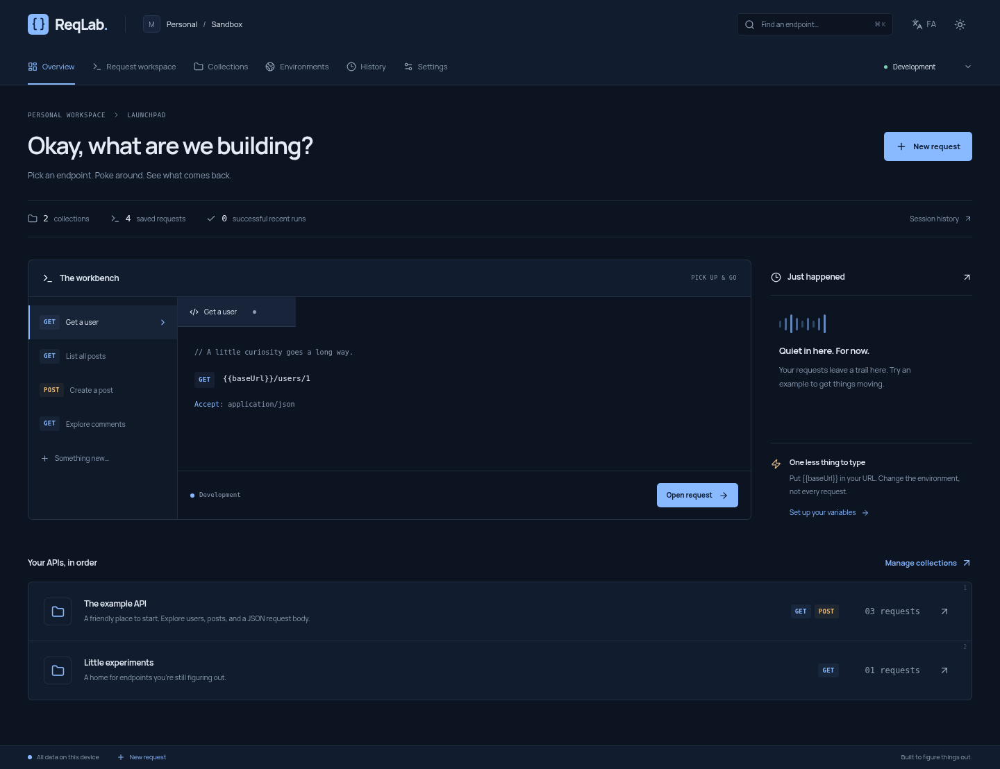

<div align="center">

# ReqLab

**Your APIs. Your workspace. A little less friction.**

A local-first API testing client with collections, environments, and clear, inspectable responses.

[Features](#features) · [Getting started](#getting-started) · [Design](docs/DESIGN.md) · [Architecture](docs/ARCHITECTURE.md) · [فارسی](docs/README.fa.md)

  



</div>

## Features

- A full product landing page and six dedicated dashboard pages.
- Compose GET, POST, PUT, PATCH, DELETE, HEAD, and OPTIONS requests with custom headers and JSON/text bodies.
- Organize saved requests in collections; reuse `{{variables}}` across URLs, headers, and bodies.
- Switch environments, inspect formatted JSON and response headers, and replay recent history.
- Cancel in-flight requests, handle 30-second timeouts, and resume your latest draft automatically.
- Versioned localStorage, Zod-validated backups, import/export, and cross-tab updates.
- English and Persian, RTL layout, bundled Manrope/Vazirmatn fonts, light/dark themes.
- Responsive navigation, accessible dialogs, visible focus states, reduced-motion support.

## Getting started

Requires **Node.js 24** and npm. No API keys, database, or environment variables.

```bash
npm ci
npm run dev
```

Open the development server on port 3000. To run both projects together, start ReqLab with `npm run dev -- --port 3001`.

```bash
npm run build
npm start
```

Any host supporting Next.js 16 can run the production build. No deployment has been provisioned.

## Validation

```bash
npm run lint
npm run typecheck
npm test
npx playwright install chromium   # once, if a system Chromium is unavailable
npm run test:e2e
```

The browser suite covers localization and theme persistence, mobile navigation and overflow, JSON backup recovery, corrupt-storage handling, and an actual HTTP POST to a local CORS test server, response replay, environment interpolation, collection persistence, and network failures. It needs no external API credentials. Playwright starts a development server if one is not already running. CI runs the same checks plus a production build.

## Data ownership & limits

Workspace data lives in this browser and origin; a different port, hostname, browser, or device has a separate workspace. There is no cloud sync or account system. Browser storage is not a durable backup. Export JSON regularly, especially before clearing site data. Imports **replace** the current workspace after confirmation. Invalid stored data is preserved until an explicit user edit or restore; storage failures are reported in the UI.

Requests execute directly in the browser: the target API must permit CORS, and HTTPS pages cannot call insecure non-loopback HTTP endpoints. Cookies and browser credentials are omitted. No proxy bypasses these restrictions. Responses are streamed and capped at 100 KB; the last 10 runs are retained. Response size/time describe the captured, decoded browser response, not total wire transfer. Secret-looking variable fields are masked visually but stored as plain text and included in backups. Never share an export with credentials.

TanStack Query is deliberately omitted: requests are user-triggered operations with cancellation and explicit history, rather than a shared remote-data cache. React manages UI state and a validated local store owns persistence.

## GitHub Projects

The tracked [project plan](.github/project-plan.json) contains completed v1 milestones and an optional backlog. A real GitHub Project can be populated and linked using:

```bash
node scripts/setup-github-project.mjs --dry-run
node scripts/setup-github-project.mjs
```

This uses GitHub CLI authentication with Projects access and `api.github.com` connectivity. It reuses a matching project and task titles to avoid duplicates. A checked-in plan is **not** proof that a GitHub Project has been created. The script fails before writes when API access is unavailable. Check the printed project URL after a successful run.

## Screenshots

[Landing](docs/screenshots/landing-dark.png) · [Workspace](docs/screenshots/dashboard-dark.png) · [Persian / light](docs/screenshots/dashboard-fa-light.png) · [Mobile](docs/screenshots/mobile.png)

## License

[MIT](LICENSE) © 2026 Mohammad / mmdbazooka
